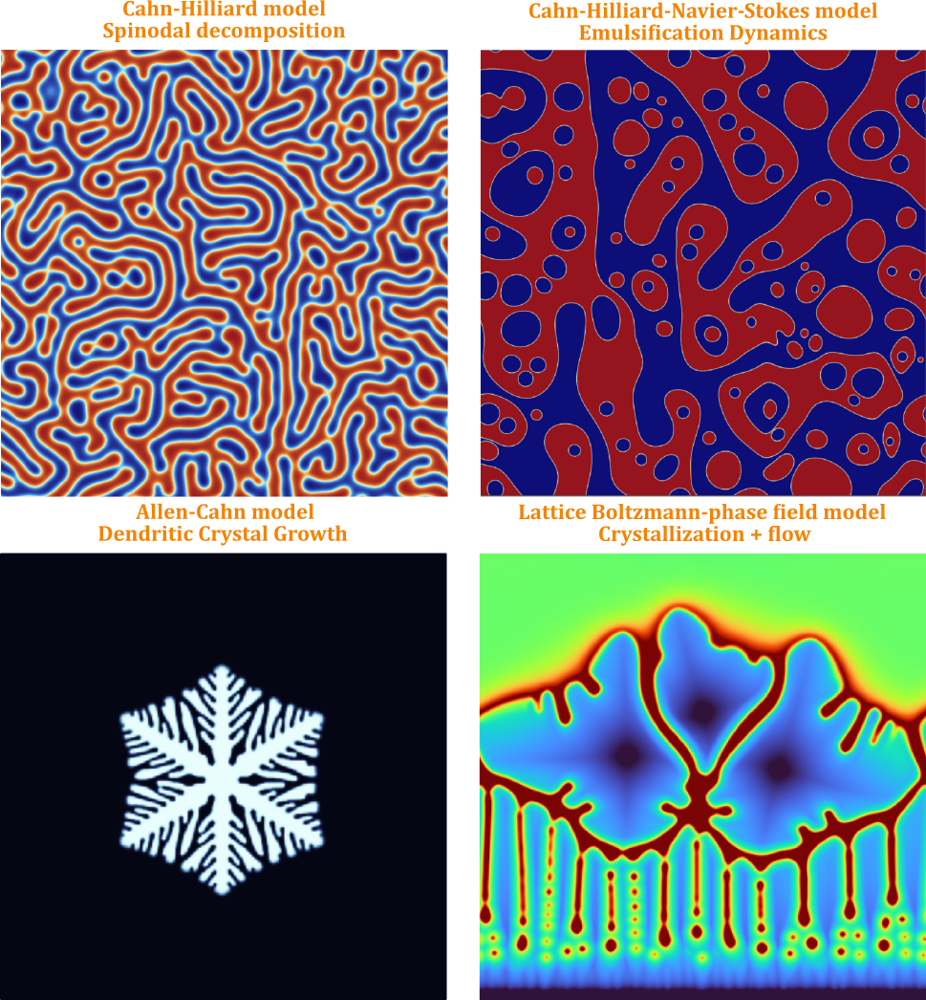

# Ignatii Efimov, Ph.D.

**FWO Postdoctoral Fellow | Ghent University, Belgium**

Computational Polymer Science · Reaction Kinetics ·
Phase-Field Modeling · Machine Learning · Morphology

## About Me

I am a computational physical chemist working at the
Centre for Polymer and Material Technologies (CPMT),
Ghent University.
My research focuses on developing physics-based and
data-driven computational methods to understand and
predict the behavior of complex polymer systems.I am particularly interested in connecting molecular
reaction kinetics, thermodynamics, and morphology
evolution to advance sustainable polymer processing.

  

## Research Interests

- **Polymer Reaction Engineering**
  Kinetic Monte Carlo simulations, polymerization
  kinetics, and molecular architecture prediction.

- **Multiphase Polymer Systems**
  Cahn–Hilliard, Allen-Cahn, and Navier–Stokes
  methods for morphology evolution.

- **Machine Learning for Polymer Science**
  Molecular descriptors, interpretable ML,
  and data-driven kinetic parameter prediction.

- **Scientific Computing**
  High-performance numerical algorithms
  using C++, Julia and Python.

## Research Software

My computational research involves developing
numerical tools for:

- Multiphase flow and phase-field modeling
- Polymer morphology prediction
- Machine learning for chemical kinetics

Selected open-source projects are available
in my pinned repositories.

## Academic Profiles

- [Google Scholar](https://scholar.google.com/citations?user=AHC0FzEAAAAJ)
- [ORCID](https://orcid.org/0000-0002-1748-7172)
- [Ghent University](https://research.ugent.be/web/person/ignatii-efimov-0/en)
- [LinkedIn](https://www.linkedin.com/in/ignatii-efimov-772633250/)

